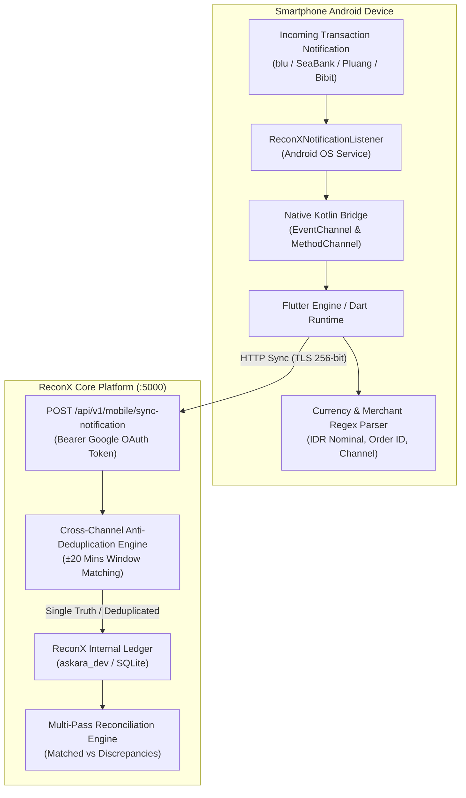

# ReconX Mobile Companion

[](https://flutter.dev)
[](https://developer.android.com)
[](LICENSE)
[](https://developers.google.com/identity)

> **Real-time Android Notification Interceptor & Automated Financial Mutasi Sync Agent** for Personal Banking, E-Wallets, E-Commerce, and Multi-Asset Investments (Pluang, Bibit, Bareksa, Stockbit, blu BCA, SeaBank, Superbank, ShopeePay, Tokopedia, OVO).

---

## 🏗️ Architecture & Data Flow



---

## 🚀 Key Highlights

1. **Native OS-Level Event Streaming (`ReconXNotificationListener.kt`):**
   - Intercepts transactions immediately when pushed to the Android notification drawer.
   - **Zero Polling & Zero Battery Drain:** Operates purely on OS callbacks (`onNotificationPosted`).
2. **10 Supported Banking, Wallet & Investment Platforms:**
   - **Pluang** (`com.pluang.android`): Saham AS, Kripto, Emas & Reksa Dana.
   - **Bibit** (`com.bibit.id`): Reksa Dana, Obligasi SBN, & Saham (KSEI settlement).
   - **Bareksa** (`com.bareksa.android`): Reksa Dana Pendapatan Tetap & Tabungan Emas.
   - **Ajaib Sekuritas** (`com.ajaib.android`): Saham IHSG & Kripto.
   - **Stockbit** (`id.stockbit.android`): Order match & trade confirmations.
   - **blu by BCA Digital** (`id.co.bcadigital.blu`): QRIS merchant, BI-FAST, mutasi keluar/masuk.
   - **SeaBank Indonesia** (`com.searpm.bank`): ShopeePay auto-debit & QRIS.
   - **Superbank Indonesia** (`id.superbank.app`): Grab transactions & Open API BI-FAST.
   - **ShopeePay** (`com.shopee.id`): Merchant QRIS & in-app checkout deductions.
   - **Tokopedia** (`com.tokopedia.tkpd`): Verified checkout receipts & GoPay payments.
   - **OVO** (`ovo.id`): Merchant kasir & minimarket QRIS.
3. **Cross-Channel Anti-Deduplication (Anti-Double Counting):**
   - When an investment or purchase generates both a **Push Notification** on your phone and an **Email Confirmation / PDF Invoice** in your inbox:
     - The ReconX backend engine cross-checks `Provider + Amount + Time Window (±20 minutes)`.
     - Data is **merged & enriched** with official invoice numbers (`PLU-992182`, `BIB-774912`), marked as `HYBRID_NOTIF_AND_EMAIL`, and **nominal rupiah is NEVER double-counted**.
4. **Google OAuth 2.0 Single Sign-On:**
   - Unified authentication matching the ReconX Web Dashboard with bearer token validation.
5. **Interactive In-App Notification Simulator:**
   - Allows instant test-firing of incoming payment notifications from inside the app without needing to execute a real purchase.

---

## 📱 Supported Target App Packages

| Platform | Android Package Name | Detection Triggers |
| :--- | :--- | :--- |
| **Pluang** | `com.pluang.android` | "Pembelian Saham AS", "Emas", "Kripto" |
| **Bibit** | `com.bibit.id` | "Pembelian Reksa Dana", "SBN", "KSEI" |
| **Bareksa** | `com.bareksa.android` | "Order Reksa Dana", "Sukses diverifikasi" |
| **Ajaib** | `com.ajaib.android` | "Order Beli Saham", "MATCH" |
| **Stockbit** | `id.stockbit.android` | "Order buy", "Executed" |
| **blu BCA** | `id.co.bcadigital.blu` | "Pembayaran QRIS", "Transfer Berhasil" |
| **SeaBank** | `com.searpm.bank` | "Transfer masuk/keluar", "QRIS" |
| **Superbank** | `id.superbank.app` | "Transfer keluar BI-FAST", "Grab" |
| **ShopeePay** | `com.shopee.id` | "Pembayaran sebesar Rp", "ShopeePay" |
| **Tokopedia** | `com.tokopedia.tkpd` | "Pembayaran pesanan Rp", "Terverifikasi" |
| **OVO** | `ovo.id` | "Berhasil bayar", "OVO Cash" |

---

## 🛠️ Quick Start & Installation

### Prerequisites
- [Flutter SDK](https://docs.flutter.dev/get-started/install) `>=3.0.0`
- Android Studio / Android SDK (API level 24+)
- ReconX Backend Server running on port 5000

### 1. Clone the Repository
```bash
git clone git@github.com:KevinNaserwan/reconx-mobile.git
cd reconx-mobile
```

### 2. Install Flutter Dependencies
```bash
flutter pub get
```

### 3. Run on Connected Device / Emulator
```bash
flutter run
```

### 4. Build Release APK
```bash
flutter build apk --release
```
The output APK will be located at:
`build/app/outputs/flutter-apk/app-release.apk`

---

## ⚙️ Configuration & Permissions

### Grant Android Notification Access
1. Launch the app on your Android smartphone.
2. Navigate to **Settings** (`Icons.settings`) -> tap **"Buka Pengaturan Izin Android"**.
3. In the Android system settings, locate **"ReconX Companion"** and toggle the permission switch **ON**.

### Configure ReconX Server IP
In **Settings**, configure the API base URL depending on your network setup:
- **Android Emulator:** `http://10.0.2.2:5000/api/v1`
- **Physical Phone on Wi-Fi:** `http://192.168.1.XX:5000/api/v1` (replace with your server/laptop LAN IP)
- **Production Server:** `https://api-reconx.yourdomain.com/api/v1`
- Tap **"Test Connection Ping"** to verify low-latency connectivity (typical ping: ~35ms).

---

## 🔒 Security & Privacy Notice
* **Local Ingestion Only:** Only notifications from registered financial and investment package IDs are intercepted.
* **No Credential Harvesting:** The app never requests your bank PIN, password, or OTP. It solely parses transaction confirmation receipts already displayed on your status bar.
* **Encrypted Transmission:** All sync payloads to the ReconX server utilize TLS 256-bit encryption with Google OAuth JWT bearer tokens.

---

## 👥 Authors & Architecture
- **Lead Fintech Architect:** Kevin Naserwan (`knaserwan`)
- **Clearing Platform Core:** ReconX Multi-Pass Payment Clearing & Settlement Engine
- **License:** MIT
